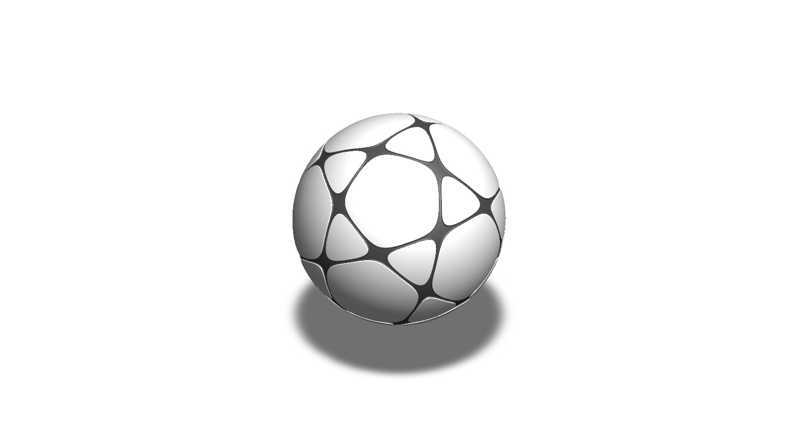
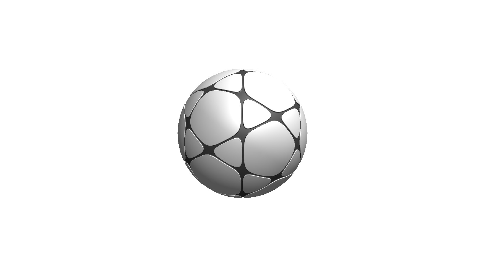
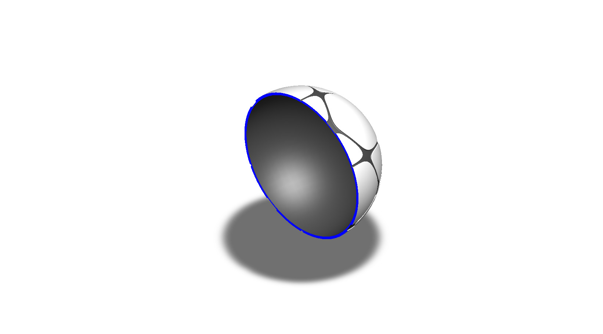
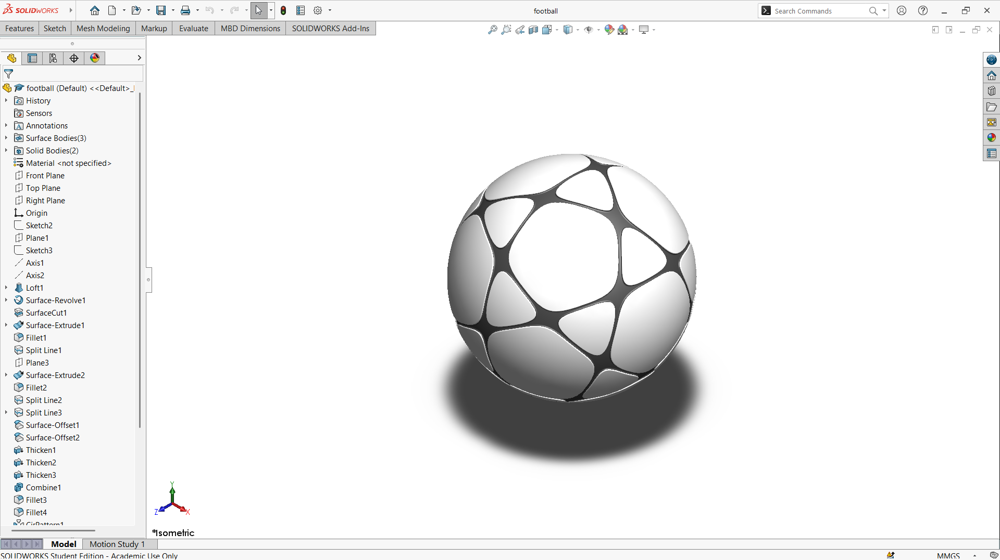
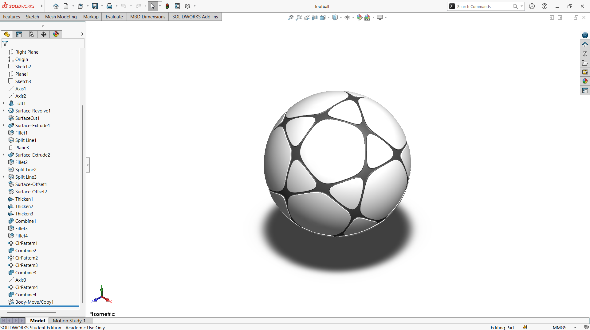

# A Rounded-Panel Football Modeled as a Hollow Shell

## Summary

I was inspired to design this football since I love playing football. The ball is the heart of the game: every pass, dribble, and shot depends on how it is shaped and how it responds to a player's touch. Spending so much time playing with it made me curious about how a ball that looks so simple is actually put together, and I wanted to recreate it myself.

The ball has a hollow, spherical shell whose surface is divided into smooth, rounded panels. Dark seams run between the panels and meet at small junctions, which gives the ball its familiar patchwork look. The section view shows that the model is a thin shell rather than a solid sphere, as in a real football where the outer casing surrounds an air-filled interior. The main challenge was to arrange the panels so that they cover the sphere evenly, with seams of consistent width, and no gaps or overlaps between neighboring panels.

The football was developed as a computational model in SolidWorks. The views below show the panel pattern from every side, along with the section view of the shell. This prototype is a base concept design that can be developed further into a ball that follows real football specifications.

---

## Computational Design

|   View    |                         Image                         |
| :-------: | :---------------------------------------------------: |
| Isometric |  |
|   Left    |            |
|   Right   |          |
|   Back    |            |
|   Front   |          |
|    Top    |              |
|  Bottom   |        |
|  Section  |      |

---

## Software Used

| Purpose |               Name                |
| :-----: | :-------------------------------: |
| Design  | SolidWorks 2024 (Student Version) |

---

## Feature Tree

| No  |       Name       |
| :-: | :--------------: |
| 01  |      Plane       |
| 02  |       Axis       |
| 03  |       Loft       |
| 04  | Surface Revolve  |
| 05  |   Surface Cut    |
| 06  | Surface Extrude  |
| 07  |      Fillet      |
| 08  |    Split Line    |
| 09  |     Thicken      |
| 10  |     Combine      |
| 11  | Circular Pattern |
| 12  |  Body Move/Copy  |

---

## Feature Tree Image

| No  |                              Image                               |
| :-: | :--------------------------------------------------------------: |
| 01  |  |
| 02  |  |

---

## Applications [^1][^2]

- Professional and Competitive Match Play
- Team Training and Practice
- Individual Dribbling, Passing, and Shooting Drills
- Recreational and Casual Play
- School Physical Education
- Futsal, Street, and Freestyle Variants

---

## Design Limitations

The design of the football was developed as a prototype product. That’s why the real-life design considerations, including panel material, bladder and valve construction, compliance with official size and weight standards, impact and flight performance, proper design specification, monetization, and feasibility, have not been included.

---

## Future Improvements

The model captures only the panel layout and shape of the ball. A real football needs a defined panel material, stitching or thermal-bonding seams, an inner bladder, and a valve, none of which are modeled. Future work should include checking size, mass, and sphericity against the governing football specifications, simulating the impact and rebound behavior, and comparing different panel counts and patterns for flight stability. Separate match, training, and futsal variants could then be derived from the same base model.

---

## Acknowledgements

Special thanks to the [EasyCAD Solutions](https://www.youtube.com/@EasyCADSolutions) YouTube channel for the SolidWorks tutorials that helped in creating this design. I would also like to thank the [CAD CAM Tutorials](https://www.youtube.com/c/CADCAMTutorials) YouTube channel for its tutorials and learning resources, and [Mr. Md. Abdus Salam](https://mpe.iutoic-dhaka.edu/profile/salam/education), Drafting Instructor, Department of Mechanical and Production Engineering, Islamic University of Technology, for his guidance and support, and for his assistance in our ME 4210 3D Solid Modeling and Assembling lab course.

---

## References

[^1]: [Which Decathlon soccer ball to choose for training, matches and casual play](https://sports.lazada.com.ph/which-decathlon-soccer-ball-to-choose-for-training-matches-and-casual-play-ph/)

[^2]: [Sports training device and methods of use (US Patent 11185750)](https://image-ppubs.uspto.gov/dirsearch-public/print/downloadPdf/11185750)
